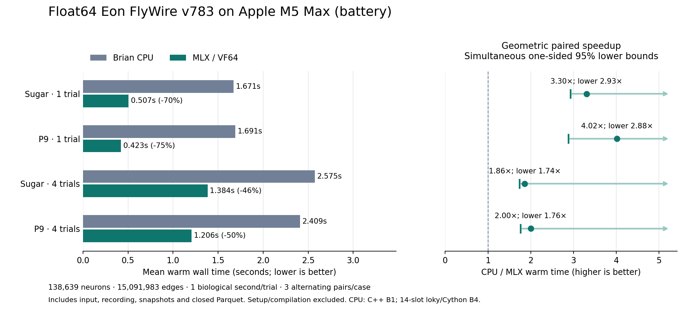
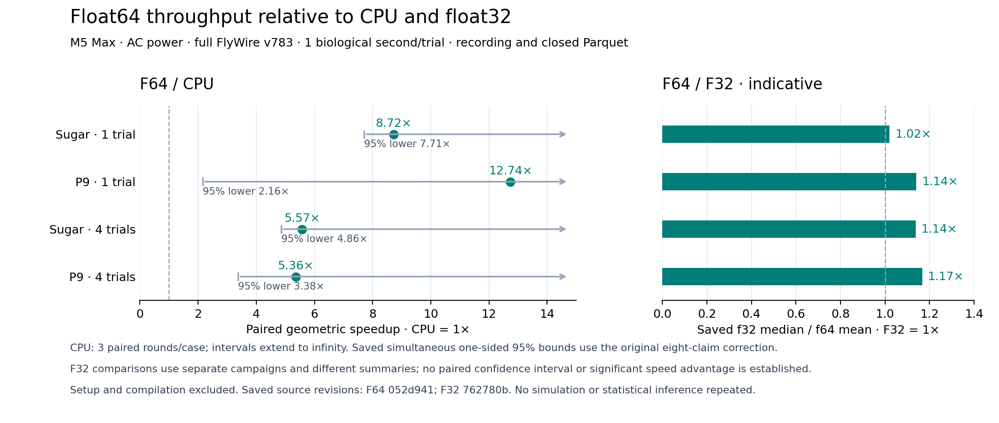

# Float64 MLX performance and verification

The controlled AC experiment used an Apple M5 Max with 128 GiB memory,
macOS 26.4, 18 logical CPU cores, and default power mode (`powermode 0`).
The optimized code is `052d941cd4a3ab278b0d57bd66c8445888582efc`.
The pre-optimization code is `cbf79ac10917493aec42942f1d7577eafbbf6592`.
Each observation staged all six production files from its verified revision.

## Warm performance

Every trial simulated one biological second at 0.1 ms on the complete FlyWire
v783 graph: 138,639 neurons and 15,091,983 connections. All observations recorded
complete six-column Brotli Parquet. Each case used three fixed measured rounds
after a separately disposable workflow for each backend.

| Case | CPU s | Previous MLX s | Optimized MLX s | MLX wall change | Optimized aggregate × real time |
|---|---:|---:|---:|---:|---:|
| Sugar, B1 | 1.653 | 0.484 | 0.190 | -60.8% | 5.27× |
| P9, B1 | 2.117 | 0.413 | 0.161 | -61.0% | 6.21× |
| Sugar, B4 | 2.488 | 1.397 | 0.447 | -68.0% | 8.96× |
| P9, B4 | 2.250 | 1.205 | 0.421 | -65.0% | 9.50× |

Means are arithmetic. MLX wall change is `100*(mean_optimized/mean_previous-1)`;
negative values mean less time. Aggregate real-time throughput is
`trials/mean_optimized_seconds`, rather than one trial's latency inside a batch.

| Case | Previous / optimized | 95% lower | CPU / optimized | 95% lower |
|---|---:|---:|---:|---:|
| Sugar, B1 | 2.55× | 2.24× | 8.72× | 7.71× |
| P9, B1 | 2.58× | 1.55× | 12.74× | 2.16× |
| Sugar, B4 | 3.13× | 2.75× | 5.57× | 4.86× |
| P9, B4 | 2.87× | 2.03× | 5.36× | 3.38× |

Ratios are geometric means of the three same-round ratios. Bounds are
simultaneous one-sided 95% lower bounds for all eight claims. The method uses
log ratios, Student t with two degrees of freedom, and Bonferroni adjustment
(`t=8.86020003465431`). Every lower bound exceeds 1.0.

Each measured round used a different fixed order: previous/optimized/CPU,
optimized/CPU/previous, then CPU/previous/optimized. Thus, each backend occupied
each position once. Hardware, OS, compiler, packages, AC source and complete
power policy matched before and after every observation. Load and process
snapshots were retained. These are same-Mac results, not GeNN/CUDA comparisons.

Native warm time includes input generation, synchronized execution, recording,
physical-state snapshots, cleanup, and the complete adapter output tail.
CPU timing ends at closed Parquet output, before its remaining summary/logging
tail. This conservatively charges the GPU extra work. Data/graph preparation,
compilation, and disposable warm-up are excluded from primary warm time.

Across measured native runs, excluded adapter/graph preparation plus compilation
took 6.37–8.66 seconds for the previous implementation and 6.09–7.82 seconds
for the optimized implementation. C++ builds took 2.83–6.21 seconds. Cython
worker preparation occurred before its common release barrier. Warm ratios
therefore describe repeated execution, rather than cold start.

CPU B1 uses the original C++ standalone route. CPU B4 uses the original 14-slot
loky configuration with four prepared Brian Cython workers and a verified private
binary cache. Native uses production MLX/VF64 kernels and PCG64 inputs.
CPU Brian and native PCG64 streams differ. Numerical qualification uses separate
identical-input controls; these independently generated CPU/native runs do not.

## Comparison with float32

Following the float32 implementation, external VF64 arithmetic enabled a compact
float64 backend with similar throughput and exact CPU-reference agreement.

| Case | Float64 / CPU throughput | Float64 / float32 throughput, indicative |
|---|---:|---:|
| Sugar, B1 | 8.72× | 1.02× |
| P9, B1 | 12.74× | 1.14× |
| Sugar, B4 | 5.57× | 1.14× |
| P9, B4 | 5.36× | 1.17× |

Higher ratios mean faster float64 execution. CPU ratios and confidence bounds
are reused unchanged from the controlled campaign above. Float32 ratios divide
its saved median warm times by float64's saved means from separate M5 Max/AC
campaigns. These are descriptive comparisons; no paired float32/float64
confidence interval establishes a significant speed advantage.

The [float32 implementation and qualification](https://github.com/ocasta181/fly-brain/blob/b2661b43b519f11ecd475f4468b0226a298f25d5/README.md#apple-silicon-float32-mlx)
bind to tested runtime `762780b8bc83b75999e19466bf649f62fdd6e08b`.
Float32 qualification covers selected scientific readouts. Float64 qualification
covers CPU state bits and ordered spikes in the documented identical-input checks.
This presentation reuses recorded results without rerunning simulations or
recalculating either campaign's accepted statistics.

## Individual observations

| Case | Round | Order | CPU s | Previous MLX s | Optimized MLX s |
|---|---:|---|---:|---:|---:|
| Sugar, B1 | 1 | baseline / candidate / cpu | 1.611579 | 0.484276 | 0.189525 |
| Sugar, B1 | 2 | candidate / cpu / baseline | 1.673700 | 0.491451 | 0.187645 |
| Sugar, B1 | 3 | cpu / baseline / candidate | 1.673135 | 0.476531 | 0.191631 |
| P9, B1 | 1 | baseline / candidate / cpu | 1.515546 | 0.396157 | 0.139303 |
| P9, B1 | 2 | candidate / cpu / baseline | 1.889518 | 0.439538 | 0.188549 |
| P9, B1 | 3 | cpu / baseline / candidate | 2.946001 | 0.404386 | 0.155386 |
| Sugar, B4 | 1 | baseline / candidate / cpu | 2.466647 | 1.445607 | 0.450276 |
| Sugar, B4 | 2 | candidate / cpu / baseline | 2.444822 | 1.389782 | 0.445000 |
| Sugar, B4 | 3 | cpu / baseline / candidate | 2.553585 | 1.357060 | 0.444540 |
| P9, B4 | 1 | baseline / candidate / cpu | 2.228267 | 1.223686 | 0.434145 |
| P9, B4 | 2 | candidate / cpu / baseline | 2.234797 | 1.162124 | 0.375940 |
| P9, B4 | 3 | cpu / baseline / candidate | 2.287399 | 1.228213 | 0.453292 |

The AC campaign collected all declared observations without retrying or dropping
a sample. Both watchdogs verified that all owned process groups were gone.
A preceding candidate-only cohort encountered a battery/AC mismatch. Its results
remain nonqualifying and separate. Earlier accepted battery results remain
unchanged. Raw receipts, diagnostic failures, and cumulative runtime remain in
ignored `executions/`; no campaign runner or execution log is shipped.

## Correctness, implementation and resources

Actual Brian2 C++ and actual Metal execution agreed on raw binary64 physical
state, refractory flags, counts, delayed state, and ordered spikes with identical
supplied inputs. Controls include original, nondefault, and zero-rest parameters,
duplicate channels/edges, distinct trials, cancellation, and boundaries.
The full v783 Sugar one-second shared-input check covered 10,000 ticks and
17019 ordered spikes. Its native state and event hashes also matched the
corresponding generated-input performance observation.
Every native previous/optimized pair in the AC campaign also matched all six
final state arrays, input-seed metadata, and complete ordered spike output.

The implementation queues bounded dependent blocks, packs delayed spike history,
and groups active neurons before state execution. The exact resting-state shortcut
does not prune small conductances. Default refractory recovery caches an absolute
tick while preserving the original physical last-spike time. An independent
captured Brian clock predicate and native VF64 check covered the int32 horizon.
Traced and nondefault models preserve their existing arithmetic path.

The 43-tick resource check covered B1, B4, and B32. Peak active Metal memory
reached 793,194,823 bytes; active allocations returned to zero after release.
The stable allocator cache retained 926,843,816 bytes. Streaming, recording-off,
repeated runs, and recovery after an injected sink failure preserved physical
state. These allocation observations are not B32 throughput measurements.

Backend and adapter code total 1,433 physical Python lines, up 87 lines from the
pre-optimization implementation. Maintained tests and helpers total 1,399 lines,
up 26. No alternate engine or numerical dependency was added.

Qualification used Python 3.10.14, NumPy 1.26.4, MLX/Metal 0.32.3, Brian2 2.8.0,
and Apple Clang 21. The C++ policy is `-O3 -ffast-math -fno-finite-math-only
-march=native -std=c++11`. VF64 source remains pinned to
`8dae385a16493282e2a3e90e4cd1aa1250b36dc5`. The unchanged CPU numerical source,
`code/run_brian2_cuda.py`, has SHA-256
`0184fb8bbd28e36643a0bcffbe64675d58cb1bcce27cbe1fc08deb8cb1777722`.
